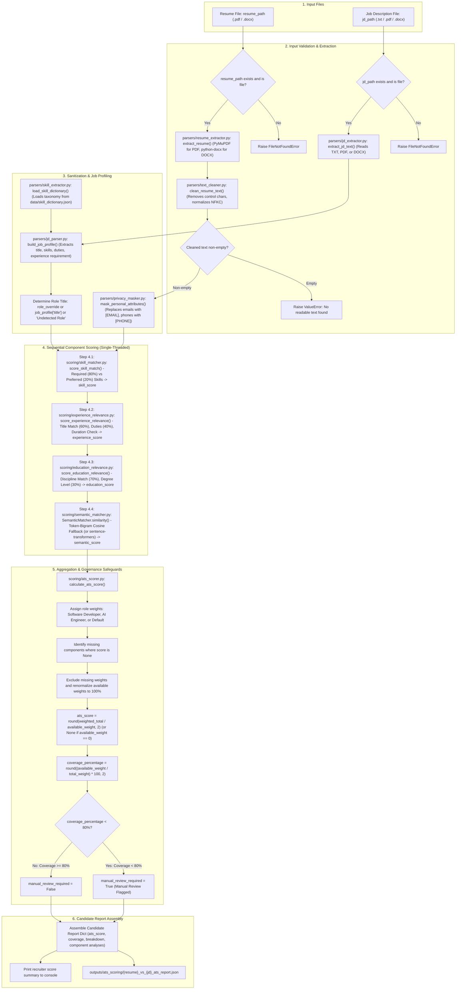
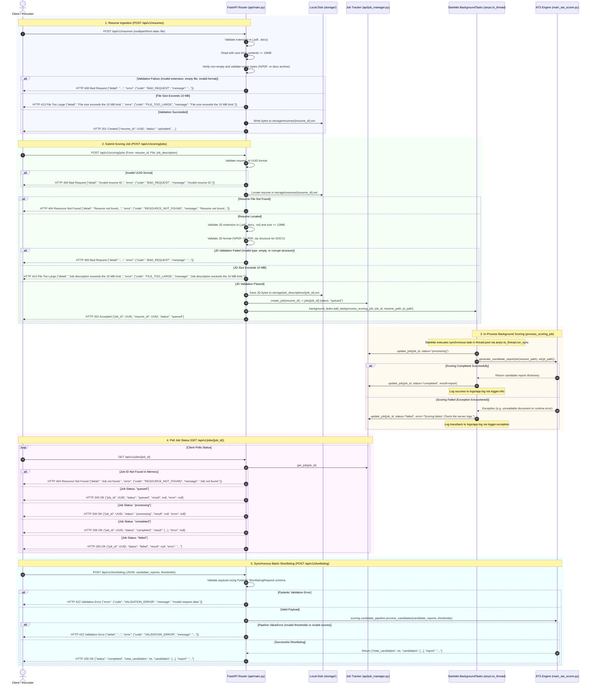

# Zecpath AI – ATS Architecture Diagrams

This document provides visual representations of the Zecpath AI Applicant Tracking System (ATS) architecture, scoring pipeline, and API workflows based strictly on the current Python implementation.

---

## 1. High-Level System Architecture

The following diagram illustrates the overall system architecture, depicting user touchpoints, application entry points, core scoring orchestration, document ingestion, component scoring, aggregation and governance, batch ranking, and persistent storage versus volatile memory.

```mermaid
flowchart TD
    subgraph Clients["User & Client Interfaces"]
        CLI_User["Terminal User / Recruiter"]
        API_Client["HTTP REST Client / Recruiter Web App"]
    end

    subgraph EntryPoints["Application Entry Points"]
        CLI_Single["main_ats_scorer.py: main() (Single Candidate CLI)"]
        CLI_Batch["main_candidate_ranking.py: main() (Batch Ranking CLI)"]
        API_Main["api/main.py (FastAPI REST Service on Uvicorn)"]
    end

    subgraph CoreEngine["Core Candidate Scoring Pipeline"]
        Core_Scorer["main_ats_scorer.py: generate_candidate_report()"]
    end

    subgraph StorageLayer["Data & File Storage"]
        Disk_Resumes["storage/resumes/ (Uploaded PDF & DOCX Files)"]
        Disk_JDs["storage/job_descriptions/ (Uploaded PDF, DOCX, TXT Files)"]
        Skill_Taxonomy["data/skill_dictionary.json (Taxonomy & Synonyms)"]
        Memory_Jobs["api/job_manager.py (Volatile In-Memory Dict: jobs = {})"]
    end

    subgraph IngestionLayer["Ingestion & Sanitization Layer"]
        Parser_Resume["parsers/resume_extractor.py (PDF & DOCX Parsers)"]
        Parser_JD["parsers/jd_extractor.py (Text / PDF / DOCX Extractor)"]
        Cleaner["parsers/text_cleaner.py (Control Char & Whitespace Sanitizer)"]
        Parser_Profile["parsers/jd_parser.py (build_job_profile: Role & Skills)"]
        Masker["parsers/privacy_masker.py (mask_personal_attributes: [EMAIL], [PHONE])"]
    end

    subgraph ScoringLayer["Component Scoring Layer (Strictly Sequential Execution)"]
        Score_Skill["1. scoring/skill_matcher.py (Required 80%, Preferred 20%)"]
        Score_Exp["2. scoring/experience_relevance.py (Title 60%, Duties 40% + Timeline)"]
        Score_Edu["3. scoring/education_relevance.py (Field 70%, Degree Level 30%)"]
        Score_Sem["4. scoring/semantic_matcher.py (Token-Bigram Cosine Fallback)"]
    end

    subgraph GovernanceLayer["Aggregation & Governance Layer"]
        ATS_Aggregator["scoring/ats_scorer.py (calculate_ats_score)"]
        Coverage_Gate{"Data Coverage >= 80%?"}
        Flag_Review["manual_review_required = True (Manual Review Flag)"]
        Pass_Review["manual_review_required = False"]
    end

    subgraph RankingLayer["Batch Ranking & Shortlisting Layer"]
        Pipeline["scoring/candidate_pipeline.py (process_candidates)"]
        Ranker["scoring/candidate_ranker.py (Stable TimSort by ats_score)"]
        Shortlister["scoring/shortlisting.py (Threshold Decision Classifier)"]
        Report_Text["scoring/ranking_report.py (generate_ranking_report)"]
    end

    subgraph OutputLayer["Reports & Responses"]
        Single_Report["outputs/ats_scoring/*_ats_report.json"]
        Batch_Report["outputs/candidate_ranking/ranked_candidates.json & report.txt"]
        API_JSON["HTTP REST JSON Responses"]
    end

    subgraph Utilities["Supporting Utilities"]
        App_Logger["utils/logger.py (logs/app.log)"]
        File_Saver["utils/file_handler.py (save_json)"]
    end

    %% Client Interactions
    CLI_User -->|Runs single evaluation CLI| CLI_Single
    CLI_User -->|Runs batch ranking CLI| CLI_Batch
    API_Client -->|HTTP REST Requests| API_Main

    %% Storage connections
    API_Main -->|Saves uploaded resumes| Disk_Resumes
    API_Main -->|Saves uploaded JDs| Disk_JDs
    API_Main -->|Tracks in-memory job state| Memory_Jobs

    %% Invocation of core scoring
    CLI_Single -->|Parses CLI args & invokes| Core_Scorer
    API_Main -->|Background worker: process_scoring_job invokes| Core_Scorer

    %% Core Scorer to Ingestion
    Core_Scorer --> Parser_Resume
    Core_Scorer --> Parser_JD
    Disk_Resumes --> Parser_Resume
    Disk_JDs --> Parser_JD

    Parser_Resume --> Cleaner
    Cleaner --> Masker
    Parser_JD --> Parser_Profile
    Skill_Taxonomy --> Parser_Profile

    %% Sequential Pipeline execution
    Masker --> Score_Skill
    Parser_Profile --> Score_Skill
    Skill_Taxonomy --> Score_Skill

    Score_Skill --> Score_Exp
    Score_Exp --> Score_Edu
    Score_Edu --> Score_Sem

    Score_Sem --> ATS_Aggregator
    ATS_Aggregator --> Coverage_Gate
    Coverage_Gate -->|No| Flag_Review
    Coverage_Gate -->|Yes| Pass_Review

    Flag_Review --> Single_Report
    Pass_Review --> Single_Report

    %% Batch Ranking Flow
    Single_Report -->|Passed via --reports CLI arg (load_candidate_reports)| CLI_Batch
    CLI_Batch -->|Calls process_candidates()| Pipeline
    API_Main -->|POST /api/v1/shortlisting payload calls| Pipeline

    Pipeline --> Ranker
    Ranker --> Shortlister
    Shortlister --> Report_Text
    Report_Text --> Batch_Report
    Report_Text --> API_JSON
```

### Explanation of High-Level Architecture

1. **User and Client Interfaces**: Users interact with the ATS via terminal CLI scripts (`main_ats_scorer.py`, `main_candidate_ranking.py`) or through HTTP REST clients and web applications calling the FastAPI service (`api/main.py`).
2. **Scoring Function Invocation vs. CLI Entry Point**:
   - `main_ats_scorer.py` serves a dual purpose: its `main()` block parses CLI arguments for command-line execution, while its [`generate_candidate_report()`](file:///d:/Desktop/Zecser%20Bussiness/zecpath-ai/main_ats_scorer.py#L42) function encapsulates the core scoring pipeline.
   - The FastAPI background worker (`process_scoring_job` in `api/main.py`) directly imports and invokes `generate_candidate_report(resume_path, jd_path)`. It does **not** execute the CLI entry point.
3. **Sequential Scoring vs. API Background Execution**:
   - **Inside the scoring function**: All four scoring components (`score_skill_match`, `score_experience_relevance`, `score_education_relevance`, and `SemanticMatcher.similarity`) execute strictly in sequential order on a single thread.
   - **In the API layer**: Scoring is decoupled from the HTTP response loop using Starlette's `BackgroundTasks`, which dispatches synchronous scoring jobs (`process_scoring_job`) to an in-process thread pool via `anyio.to_thread.run_sync`.
4. **Batch Ranking Workflow**:
   - **CLI Flow**: `main_candidate_ranking.py` takes existing single candidate JSON report paths via `--reports`, reads and validates them with `load_candidate_reports()`, and forwards the parsed dictionaries to `scoring/candidate_pipeline.py::process_candidates()`.
   - **API Flow**: `POST /api/v1/shortlisting` receives candidate report objects directly in the JSON request body (`ShortlistingRequest`) and forwards them to `scoring/candidate_pipeline.py::process_candidates()`.
   - Reports on disk do not feed into the pipeline autonomously; they are ingested either via CLI arguments or API payloads.
5. **Data Storage vs. In-Memory Volatility**:
   - Document files are persistently stored on disk in `storage/resumes/` and `storage/job_descriptions/`.
   - In contrast, API job states are held in volatile process memory (`jobs = {}` in `api/job_manager.py`). Job records are lost upon server restart and are not shared across multi-worker deployments.
6. **Inactive Scaffolding**:
   - The directories `ats_engine/`, `interview_ai/`, and `screening_ai/` contain only empty `__init__.py` files and are inactive scaffolding not connected to the current runtime architecture.

---

## 2. End-to-End ATS Processing Workflow

The following flowchart shows the exact sequential processing path executed by [`main_ats_scorer.py::generate_candidate_report()`](file:///d:/Desktop/Zecser%20Bussiness/zecpath-ai/main_ats_scorer.py#L42) when scoring a candidate resume against a job description.



### Explanation of End-to-End Processing Workflow

1. **Strictly Sequential Execution**:
   - The four scoring components are executed strictly sequentially on a single thread inside `generate_candidate_report()`.
   - Data flows from extraction to privacy masking, job profile extraction, and then sequentially through Skills -> Experience -> Education -> Semantic Similarity.
2. **Semantic Matching Implementation & Modes**:
   - **Supported Options**: `scoring/semantic_matcher.py` supports two modes:
     1. `sentence-transformers`: Dense neural embedding cosine similarity using `all-MiniLM-L6-v2`. This is an optional dependency specified in `requirements-semantic.txt`.
     2. `token-bigram-fallback`: Transparent offline lexical similarity engine that constructs L2-normalized sparse frequency vectors over alphanumeric unigrams and bigrams, cached using `@functools.lru_cache(maxsize=256)`.
   - **Current Active Configuration**: In the standard runtime environment, `sentence-transformers` is not installed. At initialization, `_check_sentence_transformers()` returns `False`, configuring the matcher to operate in `token-bigram-fallback` mode (`self.mode = "token-bigram-fallback"` and `self.model = None`).
   - **Empty Resume vs. Empty Job Description Handling**:
     - **Empty Resume**: An empty or whitespace-only resume is rejected early in [`main_ats_scorer.py:54-55`](file:///d:/Desktop/Zecser%20Bussiness/zecpath-ai/main_ats_scorer.py#L54-L55) with `ValueError("No readable text found in the resume.")`. It immediately halts execution and never reaches semantic matching or scoring.
     - **Empty Job Description**: An empty or whitespace-only job description does not raise an early extraction exception; it proceeds through the pipeline to semantic scoring.
     - **Semantic Score Normalization to `None`**: When `SemanticMatcher.similarity(text_a, text_b)` evaluates an empty JD string, lines 77–78 return `0.0` (float). In the calling pipeline ([`main_ats_scorer.py:119-120`](file:///d:/Desktop/Zecser%20Bussiness/zecpath-ai/main_ats_scorer.py#L119-L120)), an explicit condition checks `if not resume_text.strip() or not jd_text.strip(): semantic_score = None`. This converts the `0.0` score to `None`, marking semantic similarity as a missing component in `scoring/ats_scorer.py` rather than penalizing the candidate with an evaluated zero score.
3. **Component Fallbacks & Null Handling**:
   - `score_skill_match()`: Matches extracted skills against required (80%) and preferred (20%) taxonomy entries.
   - `score_experience_relevance()`: Parses employment history, merges overlapping dates, computes duration, and matches title similarity (60%) and duties (40%). Returns `None` if no work history entries are found.
   - `score_education_relevance()`: Matches academic degrees and fields of study against the target role discipline (+70 points) and recognized degree level (+30 points). Returns `None` if no education entries are found.
4. **Governance & Safeguards**:
   - When any component returns `None`, it is recorded in `missing_components`.
   - Available weights are renormalized to 100% to calculate `ats_score`.
   - If `coverage_percentage < 80%`, `manual_review_required` is set to `True` as a manual-review safeguard flag. In the downstream shortlisting classifier ([`scoring/shortlisting.py::classify_candidate`](file:///d:/Desktop/Zecser%20Bussiness/zecpath-ai/scoring/shortlisting.py#L43)), this flag assigns the recommendation label `"manual_review"` instead of `"shortlist"`, `"review"`, or `"reject_recommendation"`. The flag acts as an advisory indicator for human reviewers rather than an automated execution halt.

---

## 3. FastAPI Request and Background Job Flow

The following sequence diagram depicts the lifecycle of API requests across endpoints defined in [`api/main.py`](file:///d:/Desktop/Zecser%20Bussiness/zecpath-ai/api/main.py), illustrating input validation, disk persistence, in-memory job tracking, asynchronous in-process execution, error handling, and result retrieval.



### Explanation of FastAPI Request and Background Job Flow

1. **File Validation Rules and Size Limits**:
   - **Resumes (`POST /api/v1/resumes`)**:
     - Allowed extensions: `.pdf`, `.docx`. Other extensions raise HTTP 400 (`detail: "Only PDF and DOCX files are allowed."`).
     - Size limit: 10 MB (`10 * 1024 * 1024` bytes). Empty uploads raise HTTP 400 (`detail: "Uploaded file is empty."`). Files exceeding 10 MB raise HTTP 413 (`detail: "File size exceeds the 10 MB limit."`).
     - Content verification: PDF uploads must start with `%PDF-` (HTTP 400 if invalid). DOCX files are verified as valid ZIP archives containing `word/document.xml` (HTTP 400 if invalid).
   - **Job Descriptions (`POST /api/v1/scoring/jobs`)**:
     - Allowed extensions: `.pdf`, `.docx`, `.txt`. Other extensions raise HTTP 400.
     - Size limit: 10 MB. Empty files raise HTTP 400; files exceeding 10 MB raise HTTP 413.
     - PDF and DOCX uploads undergo the same binary format and ZIP structure checks.
2. **Actual HTTP Response Codes and Error Formats**:
   - `HTTP 201 Created`: Returned by `POST /api/v1/resumes` on successful file upload.
   - `HTTP 202 Accepted`: Returned by `POST /api/v1/scoring/jobs` when the background scoring job is accepted and queued.
   - `HTTP 200 OK`: Returned by `GET /api/v1/jobs/{job_id}` with the job state, and by `POST /api/v1/shortlisting` with the ranking result.
   - **Error Response Formats**:
     - **Endpoint `HTTPException` Handler**: Whenever an endpoint raises `HTTPException` (e.g. 400 Bad Request, 404 Resource Not Found, 413 File Too Large, or 422 for a pipeline `ValueError`), the handler returns:
       ```json
       {
           "detail": "<message>",
           "error": {
               "code": "<ERROR_CODE>",
               "message": "<message>"
           }
       }
       ```
       where `<ERROR_CODE>` is mapped by status code: 400 -> `BAD_REQUEST`, 404 -> `RESOURCE_NOT_FOUND`, 413 -> `FILE_TOO_LARGE`, 422 -> `VALIDATION_ERROR`, 500 -> `INTERNAL_SERVER_ERROR`.
     - **Request Validation Handler (`RequestValidationError`)**: When incoming request data violates the Pydantic schema (e.g. malformed fields in `POST /api/v1/shortlisting`), the handler returns HTTP 422 with:
       ```json
       {
           "error": {
               "code": "VALIDATION_ERROR",
               "message": "Invalid request data."
           }
       }
       ```
     - **General Exception Handler (`Exception`)**: Catches unhandled server exceptions, returning HTTP 500 with:
       ```json
       {
           "error": {
               "code": "INTERNAL_SERVER_ERROR",
               "message": "An unexpected server error occurred."
           }
       }
       ```
3. **Job Status Transitions (`api/job_manager.py`)**:
   - Initial state: `"queued"` (created by `create_job(resume_id)` with `result: None`, `error: None`).
   - Active state: `"processing"` (updated at start of `process_scoring_job()`).
   - Terminal success state: `"completed"` (updated with `result: candidate_report`).
   - Terminal failure state: `"failed"` (updated with `error: "Scoring failed. Check the server logs."`).
4. **Exception Handling and Result Retrieval**:
   - `process_scoring_job` executes in an in-process thread pool via `anyio.to_thread.run_sync`.
   - Unhandled exceptions within the worker do not crash the server; they are caught by `except Exception:`, which updates the job's state to `"failed"` and logs the full traceback via `logger.exception`.
   - The client retrieves results by polling `GET /api/v1/jobs/{job_id}`, which reads directly from the in-memory dictionary `jobs`.
